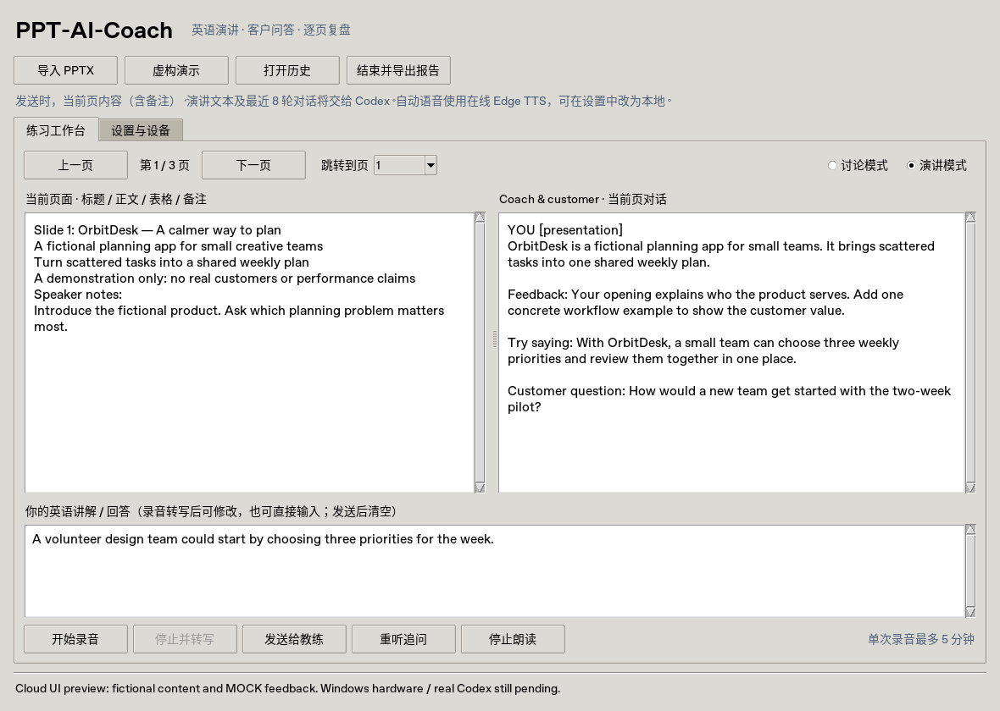

# PPT-AI-Coach

面向 **Windows 10/11 x64、Python 3.11 x64** 的 AI 英语 PPT 演讲陪练桌面软件。
使用 Tkinter、python-pptx、Faster-Whisper CPU int8，以及**你本机已经安装并登录的 Codex CLI**。

仓库：<https://github.com/ZJJUP/PPT-AI-Coach>（Public）。原创代码和虚构示例采用 [MIT](LICENSE)，第三方组件保留自己的许可，见 [第三方许可说明](THIRD_PARTY_NOTICES.md)。本次交付完整 Python 源码，不含 EXE。

## 功能与边界

- 导入 PPTX，提取标题、正文、组合形状文字、表格及可读取的演讲者备注，按页显示内容。
- 上一页、下一页或下拉跳页；每页未发送的文字草稿在当前运行中保留。
- 选择麦克风，开始/停止录音，每次最多 5 分钟，采用设备原生采样率以兼容 44.1/48 kHz 设备。
- 本机 Faster-Whisper **CPU / int8** 英语转写；检查修改后发送，也可开启自动发送或直接打字练习。
- 演讲模式：简短英文建议、自然的改写示例，以及一个具体的英文客户追问。
- 讨论模式：结合当前页与最近 8 轮上下文，评价回答并继续追问，可用麦克风多轮交流。
- Edge TTS 英语朗读，失败时尝试 Windows System.Speech/SAPI 英语语音；支持仅本地语音或关闭声音。
- 本地 JSON 保存会话，可打开历史继续；Markdown 报告包含全部逐页反馈、转写、追问及整体改进计划。
- 后台执行解析、录音、转写和 AI 调用；常见故障有操作提示，Codex 失败保留输入供重试。
- 内置原创 **OrbitDesk** 虚构产品演示，现场生成 PPTX，无真实客户或公司资料。

界面展示 **PPT 提取文本**，不渲染 PowerPoint 页面。图片文字、SmartArt、图表内部标签、动画及视频不做 OCR/还原，需手工补充。只支持无密码 `.pptx`，不支持 `.ppt/.pptm`。上限为 500 页、100 MB（解压内容上限 512 MB）。反馈只基于文字，不提供发音评分、语速测量或产品事实核验。

## Windows 安装教程

请在**家中私人 Windows 电脑**执行；首次开发和测试在云端完成，不需要在公司电脑创建项目文件。

### 1. 安装 Python 3.11 x64

从 [python.org](https://www.python.org/downloads/windows/) 安装官方 Python 3.11 x64，保留 **Tcl/Tk and IDLE** 和 **Python Launcher**，勾选 **Add python.exe to PATH**。Python 3.11.9 是提供官方传统 Windows 安装器的 3.11 版本之一。不要安装 32 位 Python。

在新开的 PowerShell 或 CMD 检查：

```powershell
py -3.11 --version
py -3.11 -m tkinter
```

第二条应打开 Tk 测试窗口，关闭即可。如果没有 `py`，重新安装 Launcher，或用已确认的 Python 3.11 完整路径替代 `py -3.11`。

### 2. 下载项目

在 GitHub 点击 **Code → Download ZIP** 并解压，例如 `D:\Projects\PPT-AI-Coach`。也可以安装 [Git for Windows](https://git-scm.com/download/win) 后执行：

```powershell
git clone https://github.com/ZJJUP/PPT-AI-Coach.git
cd PPT-AI-Coach
```

ZIP 不含 `.git` 历史，后续要用 Codex 持续维护时建议 clone。

### 3. 创建环境和安装依赖

在项目根目录执行：

```powershell
py -3.11 -m venv .venv
.\.venv\Scripts\python.exe -m pip install --upgrade pip
.\.venv\Scripts\python.exe -m pip install -r requirements-lock.txt
```

`requirements.txt` 固定直接依赖；`requirements-lock.txt` 固定 Windows x64 / Python 3.11 的传递依赖，首次安装推荐使用锁定清单。也支持 `python -m pip install -r requirements.txt`，但未来的传递依赖可能不同。无需激活环境，也不必修改 PowerShell ExecutionPolicy。

依赖 wheel 通常包含 PortAudio、libsndfile 和 PyAV 音频解码库，常规安装无需单独安装 FFmpeg。请预留数 GB 空间用于依赖和模型。

### 4. 安装、登录 Codex CLI

先安装 [Node.js 官方 LTS](https://nodejs.org/)（满足 Codex 当前要求，建议 Node.js 22 或更新 LTS），在新终端运行：

```powershell
node --version
npm install -g @openai/codex
codex --version
codex login
codex login status
codex exec --help
```

按页面提示登录**自己的账号**，使用资格、模型权限与额度由账号提供。官方文档：[Codex CLI](https://developers.openai.com/codex/cli)。本软件没有密码、Token 或 API Key 配置项，不复制认证文件。

CLI 必须支持 `exec`、`--sandbox read-only`、`--skip-git-repo-check`、`--ephemeral`、`--output-schema` 和 `--output-last-message`；参数不兼容时运行 `npm install -g @openai/codex@latest`。在终端单独验证一次真实调用（会使用服务额度）：

```powershell
codex exec --skip-git-repo-check --sandbox read-only --ephemeral "Reply with one short English greeting."
```

若 PowerShell 阻止 `codex.ps1`，可在 CMD 中执行或用 `codex.cmd` 替代 `codex`；不必关闭执行策略。运行 `where.exe codex` 找到路径，应用设置可填标准 npm 的 `codex.cmd` 或原生 `codex.exe` 完整路径，路径外不要加引号。标准 npm 安装在应用内通过 Node.js 直接启动它的 codex.js，避免 CMD 解释特殊字符；自定义 `.cmd/.bat` 包装脚本不支持。

应用以 `subprocess` 调用本机 CLI，演讲内容走标准输入，回复用 JSON Schema 校验。调用使用独立临时目录、只读沙箱和临时会话，不以 PPT 所在目录为工作目录。它沿用用户的 Codex 配置与认证；只读沙箱不等于完全隔离，用户自定义 CLI/MCP 配置仍由用户控制。

### 5. 首次下载 Whisper 模型

推荐先下载 `base.en`，或者直接录音，第一次转写会自动下载：

```powershell
.\.venv\Scripts\python.exe tools\download_model.py --model base.en
```

可选 `tiny.en/base.en/small.en/medium.en`；低内存或希望更快时选 `tiny.en`。无需 CUDA，也不必下载全部模型。下载由 Faster-Whisper/Hugging Face 完成，需要能访问 Hugging Face 及其模型下载域名，请使用自己网络允许的正常访问方式。

默认缓存：`%LOCALAPPDATA%\PPT-AI-Coach\models`。下载后可离线检查：

```powershell
.\.venv\Scripts\python.exe tools\download_model.py --model base.en --offline
```

勾选应用“Whisper 离线”后只用缓存。**这只影响转写**，Codex 和 Edge TTS 仍需网络。模型有自己的许可，保留上游模型卡。

### 6. 启动

双击 `start.bat`，或运行：

```powershell
.\start.bat
```

等价命令为 `.\.venv\Scripts\python.exe -m ppt_ai_coach`。启动脚本检查 `.venv` 和 Python 3.11，不自动安装依赖、处理登录或修改系统配置。

## 界面与练习流程



预览在 Linux 云端 Python 3.13 / Tk 8.6 虚拟显示环境生成，回复使用 **Mock**，用于说明布局；自动化测试使用 Python 3.11。**预览不代表 Windows 实机或真实 AI、音频链路已通过验证**。Windows 控件和字体外观可能不同。

1. 顶部选择“虚构演示”或“导入 PPTX”。左侧为当前页标题、正文、表格和备注，右侧为本页对话。
2. 在“设置与设备”刷新并选择麦克风，选择 Whisper 模型和语音模式，可填 Codex 路径/模型；模型留空沿用 CLI 默认。普通偏好可保存，设备每次启动重新选择。
3. 选择“演讲模式”，开始录音，讲解后停止并转写。也可直接在下方输入英文。
4. 检查转写并“发送给教练”。自动发送默认关闭，便于检查内容，可在设置中启用。
5. 教练返回 Feedback、Try saying 和 Customer question 并朗读。可以“重听追问”或“停止朗读”。开始录音会停止旧朗读，建议佩戴耳机避免回声。
6. 切换“讨论模式”，通过录音或打字回答追问，可重复多轮。发送的上下文为最近 8 轮，可能跨页；界面按页显示对话。
7. 上一页、下一页或跳页继续练习。录音/处理期间锁定切页，防止录音错配；未发送的每页草稿只在当前运行中保留。
8. “结束并导出报告”生成 `.md`。整体 AI 计划参考每页最近一次反馈和练习次数，逐页部分保留全部轮次，未练习页会标记。总结调用失败仍导出逐页反馈和明确标注的通用建议。
9. 成功收到反馈后自动保存会话；“打开历史”可恢复并继续。历史包含 PPT 提取文本，原始 PPTX 不会复制到数据目录。

## 私人数据与安全

- 默认数据目录：`%LOCALAPPDATA%\PPT-AI-Coach`，含 `sessions/`、`models/`、`settings.json`。可通过环境变量 `PPT_AI_COACH_DATA_DIR` 改到自己的其他目录，建议放在仓库之外。
- WAV、TTS MP3 和 Codex 临时输入/输出位于系统临时目录，正常处理完成（含异常）会删除；崩溃或强制退出可能留下文件，可清理 `%TEMP%` 中的 `ppt-coach-*` 目录。
- WAV 由本机 Whisper 处理，不交给 Codex。点击发送或启用自动发送后，**当前页正文/表格/备注、转写与最近讨论**经 Codex 服务处理；生成整体报告会发送每页反馈摘要。
- `auto` 语音模式将教练文字提交给 Edge 在线语音服务；不希望语音文字外发时选择 `local` 或 `off`。Codex 对话仍是联网服务。
- 历史与 Markdown 报告是**未加密的私人文本**，可能含 PPT 与演讲内容。仅导入有权处理和发送给 AI 的资料，不公开提交公司、客户、履历或真实业务资料。
- `.gitignore` 排除用户 PPT、文档、音频、JSON、模型、日志、环境和凭据；它不能拦截 `git add -f` 或写在源码/Markdown 中的秘密，提交前必须人工检查。
- 清除历史：关闭应用后删除 `%LOCALAPPDATA%\PPT-AI-Coach\sessions`；删除模型后下次需重新下载；报告需在自选目录单独删除。
- 仓库只含原创代码、测试和虚构示例生成器，不含真实用户 PPT、录音、转写或认证信息。

## 常见错误与解决方法

| 问题 | 解决方法 |
| --- | --- |
| `py` 不存在 / 版本不对 | 安装 Python 3.11 x64 和 Launcher，用 `py -0p` 确认；删除错误 `.venv` 后重建。 |
| `tkinter` / `_tkinter` 不存在 | 修改 Python 官方安装并启用 Tcl/Tk；用 `py -3.11 -m tkinter` 检查，不要 `pip install tkinter`。 |
| 缺少依赖 | 确认安装和启动都用 `.venv\Scripts\python.exe`；在项目根目录重装锁定清单。 |
| Codex 找不到 / 无登录 | 在新终端检查 `codex --version`、`codex login status`；`where.exe codex` 找路径，设置中填完整 `.cmd/.exe` 路径。 |
| Codex 超时 / 调用失败 | 检查网络、额度、登录、模型权限；更新 CLI，必要时清空模型名。超时为 180 秒，原文保留可重试；不要上传完整日志或凭据。 |
| JSON / 参数错误 | 更新 Codex CLI，核对 `exec --help` 支持上述参数；无效回复不写入历史。 |
| Codex Windows 沙箱失败 | 按官方 Windows 文档完成沙箱设置，并先验证终端调用；不要取消沙箱。原生 Windows CLI 仍待本机验证。 |
| 无麦克风 / PortAudio 错误 | Windows 设置→隐私（Win11 为隐私和安全性）→麦克风，允许访问和桌面应用访问；刷新设备，检查插头、音量、驱动及独占占用。 |
| 无声 / 过短 / 丢帧 | 至少录半秒并清楚说话；选正确输入设备、关闭高负载/独占程序，重录；也可直接输入文字。 |
| 模型下载失败 | 检查 Hugging Face 网络和磁盘空间，重跑下载；先完成下载再勾选离线。 |
| 转写慢 / 内存不足 | 改 `tiny.en`，每次录短段落；大模型首次加载更慢，默认 CPU int8。 |
| `DLL load failed` | 确保系统/Python x64；安装微软官方 [VC++ 2015–2022 x64 运行库](https://learn.microsoft.com/cpp/windows/latest-supported-vc-redist) 后重试。 |
| TTS 无声 | 检查音量和默认输出设备；切 `local`，在 Windows 语言/语音设置安装 English (United States) 语音包；文字反馈仍可用。 |
| PPT 错误 / 缺内容 | PowerPoint 另存无密码 PPTX，拆分大文件；图片与复杂图形需手动补充文字。 |
| 历史/报告无法保存 | 检查目标权限、磁盘和文件占用；当前反馈还在内存，可选其他报告位置。 |
| 历史 JSON 损坏 | 选择其他文件，目前支持 schema_version=1；不要修改 ID 或把真实会话附到公开 Issue。 |

## 测试与待验证项

云端 **Python 3.11** 实际执行核心测试和 Tkinter 虚拟显示测试。Codex、麦克风及语音外部调用使用 Mock，不消耗 API 额度。详细结果见 [验证记录](docs/VALIDATION.md)。CI 配置 Linux/Windows 核心检查和 Linux GUI Mock 测试，自动化不能代替物理设备验收。

**以下必须回到 Windows 本机验证，不能宣称通过：** 物理麦克风/权限、Whisper 真实模型下载与英语准确率、私人账号 Codex 调用/沙箱/额度、Edge 网络与 Windows MP3 播放、SAPI 英语语音、Windows Tkinter/DPI/文件对话框和 `start.bat` 双击。Windows wheel 能获取不等于 Windows 安装运行通过。

开发检查命令：

```powershell
.\.venv\Scripts\python.exe -m pip install -r requirements-dev.txt
.\.venv\Scripts\python.exe -m pytest -q -m "not gui"
.\.venv\Scripts\python.exe -m ruff check .
.\.venv\Scripts\python.exe -m ruff format --check .
```

有桌面时可运行 `python -m pytest -q -m gui`，Linux 使用 `xvfb-run -a python -m pytest -q -m gui`。测试仅用临时虚构数据。可单独生成虚构 PPTX（默认到用户数据目录）：

```powershell
.\.venv\Scripts\python.exe tools\create_demo.py
```

## 目录结构

```text
PPT-AI-Coach/
├── ppt_ai_coach/
│   ├── __main__.py       # python -m 入口
│   ├── gui.py            # 界面、后台任务和状态
│   ├── models.py         # 幻灯片、回复、对话、会话
│   ├── presentation.py   # PPTX 文字、表格和备注
│   ├── audio.py          # 录音、时长限制
│   ├── transcription.py  # Faster-Whisper CPU int8
│   ├── codex_client.py   # CLI 调用、上下文、输出校验
│   ├── speech.py         # Edge TTS / Windows SAPI
│   ├── storage.py        # 用户目录、原子 JSON
│   ├── report.py         # Markdown 导出
│   ├── demo.py           # 原创虚构演示
│   ├── errors.py
│   └── __init__.py
├── tools/                # 下载模型、生成演示
├── tests/                # 核心与 GUI Mock 测试
├── docs/                 # 预览、验证与许可记录
├── .github/workflows/    # Linux / Windows CI
├── .gitignore
├── AGENTS.md             # Codex 后续维护约定
├── requirements.txt
├── requirements-lock.txt
├── requirements-dev.txt
├── pyproject.toml
├── start.bat
├── THIRD_PARTY_NOTICES.md
├── LICENSE
└── README.md
```

## 后续更新与 Git 工作流

clone 用户在修改前同步并建分支：

```powershell
git status
git switch main
git pull --ff-only
git switch -c feat/my-improvement
```

修改后跑测试；改依赖时同步锁定清单并复查许可，可用 uv 重新解析：

```powershell
uv pip compile requirements.txt --python-version 3.11 --python-platform windows --output-file requirements-lock.txt
```

检查具体改动后提交：

```powershell
git status --short
git diff
git add ppt_ai_coach tests README.md
git diff --cached --stat
git diff --cached
git diff --cached --check
git log --oneline --all
git commit -m "feat: describe the improvement"
git push -u origin feat/my-improvement
```

在 GitHub 创建 PR，检查 Actions 后合并；再切回 main 并 `git pull --ff-only`。不要强制推送；有冲突先保留并解决，不能覆盖他人工作。ZIP 用户建议另行 clone 后迁移源码改动，不迁移历史、录音或缓存。

回家验收通过后，可让 Codex 在此仓库继续开发并单独要求 PyInstaller 打包；分发 EXE 前需复查第三方二进制及 LGPL 等再分发义务。
